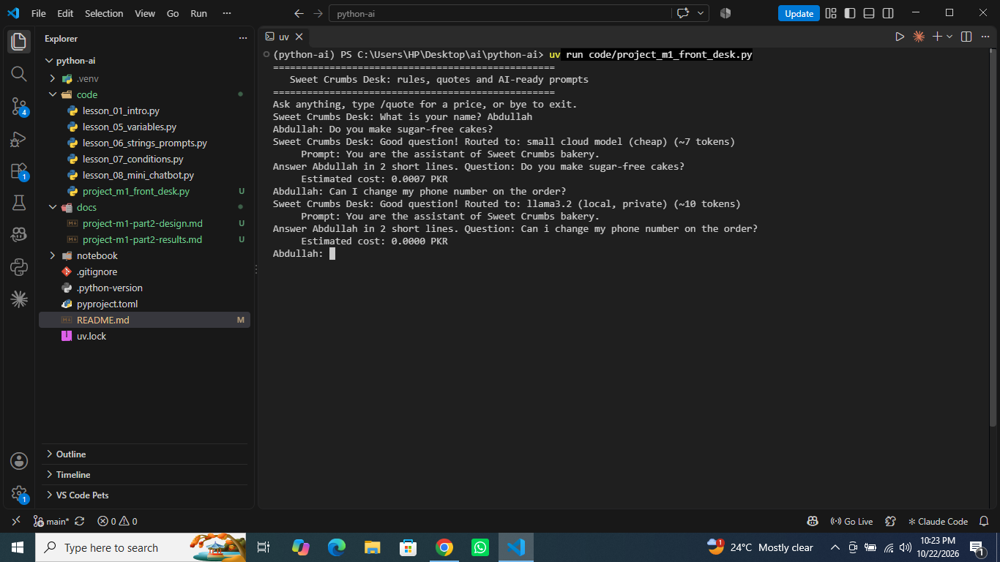

***Python-ai***

## Task 1.8: Business Helper Bot — Intent Design

**Business:** City Care Clinic

| Intent | What the user wants | Keywords to look for | Bot reply |
|---|---|---|---|
| Greeting | Say hello | `hi`, `hello`, `hey` | Hello! How can I help you today? |
| Timings | Know opening hours | `timings`, `hours`, `open`, `close` | We are open 10 am to 8 pm, Monday to Saturday. |
| Fees | Know the consultation fee | `fee`, `fees`, `price`, `cost` | Consultation fee is 2,000 PKR. |
| Location | Find the clinic | `location`, `address`, `where` | We are located in Lahore. Please contact us for the exact address. |
| Appointments | Book an appointment | `appointment`, `book`, `booking` | Please call the clinic to book an appointment. |
| Complaints | Report a problem | `complaint`, `late`, `problem`, `issue` | Sorry about that. The clinic manager will call you today. |
| Human handover | Speak to a person | `agent`, `human` | Connecting you to a human... |

**Fallback behavior:** If no intent matches, the bot counts the question as unanswered

**Exit behavior:** When the user types `bye`, the bot ends the conversation and displays the total message count, unanswered questions, and complaints received.


## Module 1 Checkpoint 2: AI Front Desk

**Project:** Sweet Crumbs Bakery — AI Front Desk

A Python-based front desk assistant that answers common bakery questions, calculates order quotes with discounts and delivery charges, routes unanswered questions to local or cloud AI models, and generates a session report.

### Features

- Answers frequently asked questions using Python rules.
- Calculates item prices, bulk discounts, delivery fees, and order totals.
- Routes private questions to a local model with an estimated AI cost of zero.
- Prepares prompts for unanswered questions and estimates cloud AI costs.
- Tracks messages, answered questions, unanswered questions, quotes, quoted value, AI costs, and complaints.
- Validates order quantities to prevent invalid numeric input from crashing the program.

### How to Run

```bash
uv run code/project_m1_front_desk.py
```

### Example Session Screenshot



### Business Value

The front desk saves staff time by answering repetitive questions automatically and reduces pricing mistakes through consistent calculations, giving the owner a practical reason to pay for the solution.

### Project Documentation

- Design and rule test results: `docs/project-m1-part2-design.md`
- AI test results: `docs/project-m1-part2-results.md`
- Main Python program: `code/project_m1_front_desk.py`
